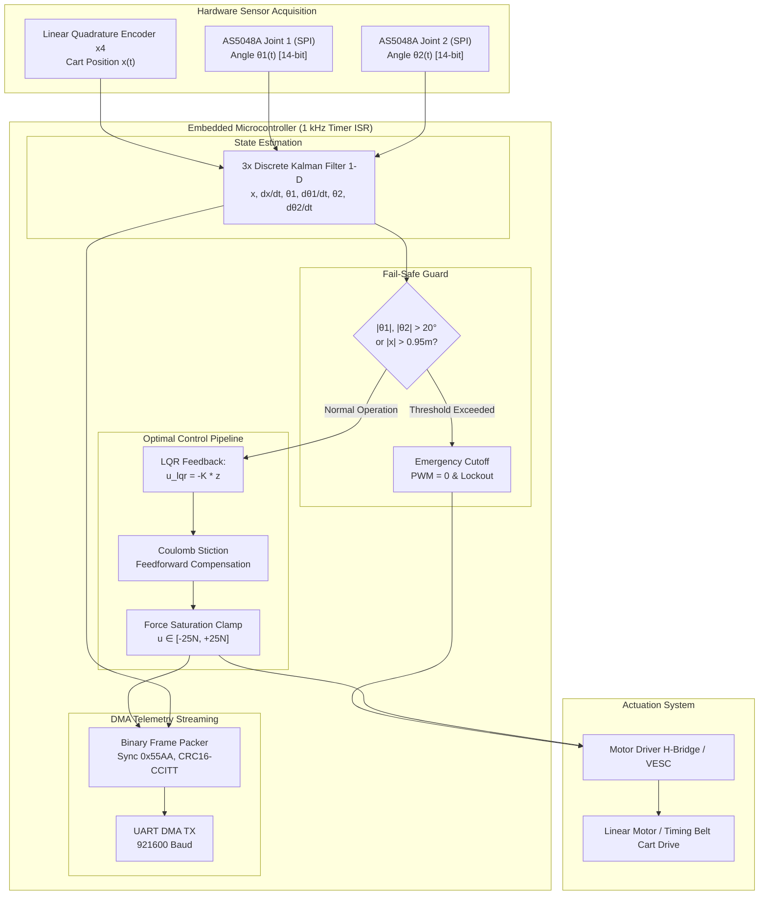

# Double Inverted Pendulum on a Cart (DIP) - Mechatronics & Embedded Control Core

[](https://github.com/organization/double_inverted_pendulum/actions/workflows/ci.yml)
[](https://opensource.org/licenses/MIT)
[](https://en.wikipedia.org/wiki/C11_(C_version))
[](https://www.python.org/)

An industrial-grade mechatronics control and simulation framework for the **Double Inverted Pendulum on a Cart (DIP)**. This repository provides an end-to-end engineering workflow: analytical nonlinear Euler-Lagrange equations of motion derived symbolically using SymPy, upright equilibrium linearization, optimal Linear Quadratic Regulator (LQR) synthesis via Bryson's Rule, nonlinear numerical integration (RK4/ODE) with force saturation and impulse disturbances, physical 3D MuJoCo simulation (MJCF), and production-ready embedded C/C++ firmware designed for a hard real-time 1 kHz Timer ISR with discrete Kalman filtering, Coulomb stiction compensation, fail-safe trip mechanisms, and high-speed DMA UART telemetry.

---

## 1. System Architecture & Principle Diagram



---

## 2. Mathematical Modeling & Analytical Derivation

### Generalized Coordinates & Euler-Lagrange Formulation
The generalized coordinate vector is defined as $\mathbf{q} = [x, \theta_1, \theta_2]^T$, where:
- $x$ is the linear displacement of the cart along the horizontal guide rail.
- $\theta_1, \theta_2$ are the angular deviations of Link 1 and Link 2 measured from the upright vertical axis ($0^\circ$, positive counter-clockwise).

The full nonlinear equations of motion in standard robotic manipulator form:

$$
\mathbf{M}(\mathbf{q})\ddot{\mathbf{q}} + \mathbf{C}(\mathbf{q}, \dot{\mathbf{q}})\dot{\mathbf{q}} + \mathbf{G}(\mathbf{q}) + \mathbf{D}\dot{\mathbf{q}} = \mathbf{B}_u u
$$

where:
- $\mathbf{M}(\mathbf{q}) \in \mathbb{R}^{3 \times 3}$ is the symmetric, positive-definite generalized inertia matrix.
- $\mathbf{C}(\mathbf{q}, \dot{\mathbf{q}})\dot{\mathbf{q}} \in \mathbb{R}^3$ represents Coriolis and centrifugal terms.
- $\mathbf{G}(\mathbf{q}) = -\nabla_{\mathbf{q}} V(\mathbf{q})$ is the gravitational restoring/destabilizing generalized force vector.
- $\mathbf{D} = \text{diag}(b, d_1 + d_2, d_2)$ denotes viscous damping at the track and joint pivots.
- $\mathbf{B}_u = [1, 0, 0]^T$ represents the control input vector mapping actuator force $u(t)$ to cart acceleration.

### Linearization Around Vertical Upright Equilibrium
Expanding about the unstable upright equilibrium $[\mathbf{q}_0, \dot{\mathbf{q}}_0] = [\mathbf{0}, \mathbf{0}]$ using first-order Taylor series yields the continuous state-space representation:

$$
\dot{\mathbf{z}}(t) = \mathbf{A}\mathbf{z}(t) + \mathbf{B}u(t)
$$

with the 6-dimensional state vector $\mathbf{z}(t) = [x, \dot{x}, \theta_1, \dot{\theta}_1, \theta_2, \dot{\theta}_2]^T$.

### LQR Optimal Synthesis (Bryson's Rule)
The continuous-time quadratic cost functional is formulated as:

$$
J = \int_{0}^{\infty} \left( \mathbf{z}(t)^T \mathbf{Q} \mathbf{z}(t) + R u(t)^2 \right) dt
$$

Using Bryson's rule to balance maximum acceptable state excursions against maximum actuator effort:

$$
Q_{ii} = \frac{1}{(\Delta z_{i,\max})^2}, \quad R = \frac{1}{(u_{\max})^2}
$$

Solving the Continuous Algebraic Riccati Equation (CARE):

$$
\mathbf{A}^T \mathbf{P} + \mathbf{P}\mathbf{A} - \mathbf{P}\mathbf{B}R^{-1}\mathbf{B}^T \mathbf{P} + \mathbf{Q} = \mathbf{0}
$$

The optimal state feedback gain matrix $\mathbf{K}$ is:

$$
\mathbf{K} = R^{-1}\mathbf{B}^T \mathbf{P} = \begin{bmatrix} k_x & k_{\dot{x}} & k_{\theta_1} & k_{\dot{\theta}_1} & k_{\theta_2} & k_{\dot{\theta}_2} \end{bmatrix}
$$

Real-time closed-loop control law:

$$
u(t) = -\mathbf{K}\mathbf{z}(t) = -\left(k_x x + k_{\dot{x}} \dot{x} + k_{\theta_1} \theta_1 + k_{\dot{\theta}_1} \dot{\theta}_1 + k_{\theta_2} \theta_2 + k_{\dot{\theta}_2} \dot{\theta}_2\right)
$$

---

## 3. Physical Benchmark Parameters

| Parameter | Symbol | Nominal Value | SI Unit | Description |
| :--- | :--- | :--- | :--- | :--- |
| Cart Mass | M | 1.20 | kg | Mass of motorized linear cart |
| Link 1 Mass | m1 | 0.15 | kg | Mass of lower pendulum rod |
| Link 2 Mass | m2 | 0.10 | kg | Mass of upper pendulum rod |
| Link 1 Length | L1 | 0.30 | m | Total length of lower rod |
| Link 2 Length | L2 | 0.25 | m | Total length of upper rod |
| Link 1 COM Distance | l1 | 0.15 | m | Center-of-mass distance (L1 / 2) |
| Link 2 COM Distance | l2 | 0.125 | m | Center-of-mass distance (L2 / 2) |
| Link 1 Inertia | J1 | 0.001125 | kg*m^2 | Inertia about center of mass |
| Link 2 Inertia | J2 | 0.000521 | kg*m^2 | Inertia about center of mass |
| Gravity | g | 9.81 | m/s^2 | Acceleration due to gravity |
| Cart Friction | b | 0.50 | N*s/m | Viscous damping on guide rail |
| Joint 1 Damping | d1 | 0.005 | N*m*s/rad | Viscous rotational friction at Joint 1 |
| Joint 2 Damping | d2 | 0.003 | N*m*s/rad | Viscous rotational friction at Joint 2 |
| Actuator Peak Force | u_max | 60.0 | N | Linear servo peak actuator force |
| Controller Frequency | f_isr | 1000 | Hz | Real-time Timer ISR execution rate |


---

## 4. Repository Structure

```text
double_inverted_pendulum/
├── .github/
│   └── workflows/
│       └── ci.yml               # Automated CI/CD: linting, LQR stability tests, C build
├── .agents/skills/              # 4 Project-Specific Custom Agent Skills
│   ├── dip-dynamics-modeling/SKILL.md
│   ├── dip-physics-simulation/SKILL.md
│   ├── dip-firmware-embedded/SKILL.md
│   └── dip-git-devops/SKILL.md
├── simulation/                  # Modeling, numerical ODE solver, visualization & 3D MuJoCo
│   ├── sympy_derivation.py      # Symbolic Euler-Lagrange equations derivation
│   ├── lqr_design.py            # CARE solver, Bryson's Rule, controllability check, C header export
│   ├── nonlinear_sim.py         # Full nonlinear ODE integration (RK4), saturation clamp & disturbance
│   ├── visualize.py             # 4-channel response plotting and performance metrics summary
│   └── model.xml                # MuJoCo MJCF 3D physics model definition with joint limits
├── firmware/                    # Production-ready embedded C/C++ source code
│   ├── include/
│   │   ├── dip_config.h         # System parameters, LQR gains, safety limits, timer configs
│   │   ├── dip_controller.h     # Controller state machine, 1 kHz ISR step interface
│   │   ├── kalman_filter.h      # Discrete 1-D Kalman Filter for angle & velocity estimation
│   │   └── telemetry.h          # Packed 44-byte binary frame definition with CRC-16 CCITT
│   └── src/
│       ├── main.c               # 1 kHz hardware timer ISR demonstration, HAL stubs
│       ├── dip_controller.c     # LQR calculation, Coulomb stiction compensation, fail-safe cutoff
│       ├── kalman_filter.c      # Kalman covariance time-update and measurement-correction
│       └── telemetry.c          # Frame serialization and CRC-16 calculation for DMA UART
├── docs/                        # Comprehensive mathematical & control architecture specifications
│   ├── dynamics_derivation.md   # Rigorous Lagrangian proofs and linearization steps
│   └── control_architecture.md  # Real-time timing budget (<17 µs/cycle), telemetry protocol
├── tests/
│   └── test_lqr_stability.py    # Unit tests verifying controllability rank = 6 and closed-loop poles
├── requirements.txt             # Python dependencies
├── .gitignore                   # Multi-language ignore rules (Python & Embedded C)
└── README.md                    # Main project documentation
```

---

## 5. Quickstart & Execution Guide

### Step 1: Install Python Dependencies
```bash
pip install -r requirements.txt
```

### Step 2: Symbolic Derivation & LQR Controller Design
```bash
# Derive nonlinear equations of motion and linearize using SymPy:
python simulation/sympy_derivation.py

# Compute state-space matrices, verify controllability, solve CARE, and export C header:
python simulation/lqr_design.py
```

### Step 3: Autonomous 3D Simulation & Self-Learning System
```bash
# 1. Launch interactive 3D simulation with autonomous self-righting:
# Starts from ANY arbitrary angle (random, hanging down, or horizontal) and physically balances:
python simulation/run_mujoco_lqr.py --init random

# Specific initial state flags:
python simulation/run_mujoco_lqr.py --init hanging      # Both poles hanging straight down (180 deg)
python simulation/run_mujoco_lqr.py --init horizontal   # Both poles horizontal (90 deg)
python simulation/run_mujoco_lqr.py --init upright      # Perturbed near upright
python simulation/run_mujoco_lqr.py --impulse           # Injects periodic disturbance pulses

# 2. Run High-Speed Headless Auto-Tuner & Evolutionary Optimizer:
# Automatically learns optimal momentum pumping and LQR weights across all angles, saving to learned_params.json:
python simulation/train_auto_tuning.py

# 3. Plot 4-channel offline RK4 time response:
python simulation/visualize.py
```

### Step 4: Run Automated Unit Tests
```bash
pytest tests/ -v
# or with standard unittest runner:
python tests/test_lqr_stability.py
```

### Step 5: Compile & Test Embedded C Firmware on Host
```bash
gcc -Wall -Wextra -O2 -I firmware/include firmware/src/*.c -lm -o firmware/dip_firmware_sim
./firmware/dip_firmware_sim
```

---

## 6. Project Custom Agent Skills

| Skill Name | Path | Function |
| :--- | :--- | :--- |
| `dip-dynamics-modeling` | `.agents/skills/dip-dynamics-modeling/` | Automates SymPy derivation, state-space linearization, controllability matrix rank evaluation, CARE solution, and optimal gain $K$ synthesis. |
| `dip-physics-simulation` | `.agents/skills/dip-physics-simulation/` | Manages nonlinear ODE integration, actuator force saturation limits, impulse disturbance tests, MuJoCo 3D model, and time-response visualization. |
| `dip-firmware-embedded` | `.agents/skills/dip-firmware-embedded/` | Generates and verifies embedded C code for 1 kHz ISR, discrete Kalman filter velocity estimators, Coulomb stiction feedforward, safety lockout ($|\theta| > 20^\circ$), and 921600-baud UART telemetry. |
| `dip-git-devops` | `.agents/skills/dip-git-devops/` | Manages Git repository hygiene, automated stability unit tests, and GitHub Actions CI/CD workflows. |
