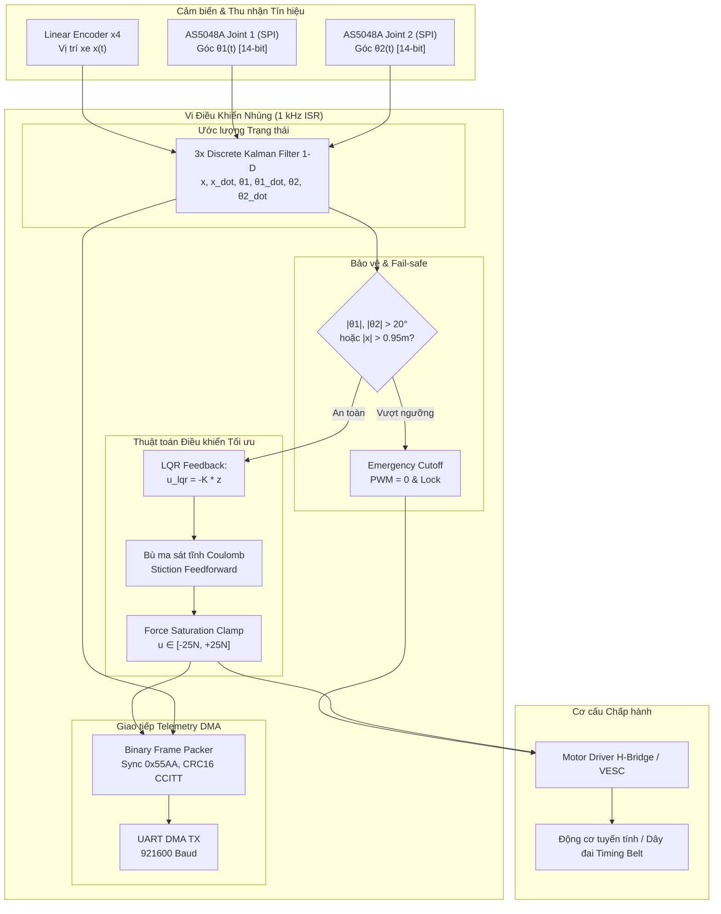

# Double Inverted Pendulum on a Cart (DIP) - Mechatronics & Embedded Control Core

[](https://github.com/organization/double_inverted_pendulum/actions/workflows/ci.yml)
[](https://opensource.org/licenses/MIT)
[](https://en.wikipedia.org/wiki/C11_(C_version))
[](https://www.python.org/)

Hệ thống điều khiển cân bằng **Con lắc ngược đôi trên xe trượt (Double Inverted Pendulum on a Cart - DIP)** cấp công nghiệp. Dự án bao gồm đầy đủ chu trình: suy dẫn giải tích phi tuyến Euler-Lagrange bằng SymPy, thiết kế bộ điều khiển tối ưu LQR (quy tắc Bryson), mô phỏng số phi tuyến thực tế kết hợp mô hình vật lý 3D MuJoCo, firmware nhúng C/C++ chuẩn 1 kHz ISR với bộ lọc Kalman rời rạc và cơ chế bảo vệ khẩn cấp Fail-safe.

---

## 1. Sơ đồ Nguyên lý & Khối Hệ thống



---

## 2. Mô hình Toán học & Công thức Giải tích

### Tọa độ suy rộng và Phương trình Euler-Lagrange
Vector tọa độ: $\mathbf{q} = [x, \theta_1, \theta_2]^T$.

Phương trình vi phân phi tuyến đầy đủ:
$$\mathbf{M}(\mathbf{q})\ddot{\mathbf{q}} + \mathbf{C}(\mathbf{q}, \dot{\mathbf{q}})\dot{\mathbf{q}} + \mathbf{G}(\mathbf{q}) + \mathbf{D}\dot{\mathbf{q}} = \mathbf{B}_u u$$

Trong đó:
- Ma trận quán tính $\mathbf{M}(\mathbf{q})$ đối xứng xác định dương.
- $\theta_1, \theta_2$ đo từ trục thẳng đứng hướng lên (upright vertical, $0^\circ$).
- Thế năng trọng trường: $V = (m_1 l_1 + m_2 L_1) g \cos\theta_1 + m_2 g l_2 \cos\theta_2$.

### Tuyến tính hóa quanh Điểm Cân bằng Thẳng đứng
Tuyến tính hóa quanh điểm cân bằng bất ổn định $[\mathbf{q}_0, \dot{\mathbf{q}}_0] = [\mathbf{0}, \mathbf{0}]$ dẫn đến hệ không gian trạng thái 6 chiều:
$$\dot{\mathbf{z}}(t) = \mathbf{A}\mathbf{z}(t) + \mathbf{B}u(t)$$
với $\mathbf{z} = [x, \dot{x}, \theta_1, \dot{\theta}_1, \theta_2, \dot{\theta}_2]^T$.

### Tổng hợp Bộ điều khiển LQR (Bryson's Rule)
Hàm chi phí tối ưu:
$$J = \int_{0}^{\infty} \left( \mathbf{z}(t)^T \mathbf{Q} \mathbf{z}(t) + R u(t)^2 \right) dt$$
Quy tắc Bryson gán trọng số theo giới hạn độ lệch cực đại:
$$Q_{ii} = \frac{1}{(\Delta z_{i,\max})^2}, \quad R = \frac{1}{(u_{\max})^2}$$
Giải phương trình đại số Riccati liên tục (CARE):
$$\mathbf{A}^T \mathbf{P} + \mathbf{P}\mathbf{A} - \mathbf{P}\mathbf{B}R^{-1}\mathbf{B}^T \mathbf{P} + \mathbf{Q} = 0$$
Độ lợi phản hồi tối ưu:
$$\mathbf{K} = R^{-1}\mathbf{B}^T \mathbf{P} = \begin{bmatrix} k_x & k_{\dot{x}} & k_{\theta_1} & k_{\dot{\theta}_1} & k_{\theta_2} & k_{\dot{\theta}_2} \end{bmatrix}$$
Luật điều khiển:
$$u(t) = -\mathbf{K}\mathbf{z}(t)$$

---

## 3. Bảng Thông số Vật lý Danh định (Benchmark Parameters)

| Ký hiệu | Ý nghĩa thông số | Giá trị danh định | Đơn vị SI |
| :--- | :--- | :--- | :--- |
| $M$ | Khối lượng xe trượt (Cart Mass) | 1.20 | $\text{kg}$ |
| $m_1$ | Khối lượng thanh lắc 1 (Pole 1 Mass) | 0.15 | $\text{kg}$ |
| $m_2$ | Khối lượng thanh lắc 2 (Pole 2 Mass) | 0.10 | $\text{kg}$ |
| $L_1$ | Chiều dài toàn phần thanh 1 | 0.30 | $\text{m}$ |
| $L_2$ | Chiều dài toàn phần thanh 2 | 0.25 | $\text{m}$ |
| $J_1$ | Quán tính khối tâm thanh 1 ($\frac{1}{12}m_1 L_1^2$) | $1.125 \times 10^{-3}$ | $\text{kg}\cdot\text{m}^2$ |
| $J_2$ | Quán tính khối tâm thanh 2 ($\frac{1}{12}m_2 L_2^2$) | $5.208 \times 10^{-4}$ | $\text{kg}\cdot\text{m}^2$ |
| $g$ | Gia tốc trọng trường | 9.81 | $\text{m/s}^2$ |
| $b$ | Ma sát nhớt trên ray dẫn hướng | 0.50 | $\text{N}\cdot\text{s/m}$ |
| $d_1$ | Ma sát cản nhớt khớp quay 1 | 0.005 | $\text{N}\cdot\text{m}\cdot\text{s/rad}$ |
| $d_2$ | Ma sát cản nhớt khớp quay 2 | 0.003 | $\text{N}\cdot\text{m}\cdot\text{s/rad}$ |
| $u_{\max}$ | Giới hạn lực động cơ bão hòa | 25.0 | $\text{N}$ |
| $f_{isr}$ | Tần số ngắt điều khiển thời gian thực | 1000 | $\text{Hz}$ |

---

## 4. Cấu trúc Dự án

```text
double_inverted_pendulum/
├── .github/
│   └── workflows/
│       └── ci.yml               # Pipeline CI/CD tự động kiểm thử và build
├── .agents/
│   └── skills/                  # 4 Custom Agent Skills độc quyền
│       ├── dip-dynamics-modeling/SKILL.md
│       ├── dip-physics-simulation/SKILL.md
│       ├── dip-firmware-embedded/SKILL.md
│       └── dip-git-devops/SKILL.md
├── simulation/                  # Mô hình hóa, giải số ODE, trực quan hóa & 3D MuJoCo
│   ├── sympy_derivation.py      # Suy dẫn phương trình Euler-Lagrange bằng SymPy
│   ├── lqr_design.py            # Tính toán ma trận CARE, Bryson's Rule, nghiệm K
│   ├── nonlinear_sim.py         # Tích phân số RK4 giải ODE phi tuyến + Saturation
│   ├── visualize.py             # Trực quan hóa đồ thị đáp ứng thời gian
│   └── model.xml                # File mô phỏng vật lý 3D chuẩn MuJoCo MJCF
├── firmware/                    # Mã nguồn C/C++ thuần cho vi điều khiển nhúng
│   ├── include/
│   │   ├── dip_config.h         # Cấu hình phần cứng, độ lợi LQR, ngưỡng an toàn
│   │   ├── dip_controller.h     # Giao diện bộ điều khiển 1 kHz & State Machine
│   │   ├── kalman_filter.h      # Bộ lọc Kalman rời rạc 1-D (Angle & Velocity)
│   │   └── telemetry.h          # Đóng gói frame nhị phân 44 bytes, CRC16-CCITT
│   └── src/
│       ├── main.c               # Vòng lặp chính, ngắt định thời 1 kHz ISR
│       ├── dip_controller.c     # Tính toán LQR, bù ma sát Coulomb, Fail-safe
│       ├── kalman_filter.c      # Thuật toán dự đoán/cập nhật Kalman
│       └── telemetry.c          # Đóng gói và tính CRC16 UART
├── docs/                        # Tài liệu kỹ thuật chi tiết
│   ├── dynamics_derivation.md   # Chứng minh toán học & đạo hàm chi tiết
│   └── control_architecture.md  # Sơ đồ khối, ngân sách thời gian thực & giao thức
├── tests/
│   └── test_lqr_stability.py    # Unit tests kiểm tra tính điều khiển được và ổn định
├── requirements.txt             # Danh sách thư viện Python
├── .gitignore                   # Bộ lọc file rác Python & C/C++ build artifacts
└── README.md                    # Tài liệu hướng dẫn sử dụng chính
```

---

## 5. Hướng dẫn Chạy & Kiểm thử

### Bước 1: Cài đặt Môi trường Python
```bash
pip install -r requirements.txt
```

### Bước 2: Chạy Suy dẫn Ký hiệu & Thiết kế LQR
```bash
# Suy dẫn phương trình phi tuyến và tuyến tính hóa bằng SymPy:
python simulation/sympy_derivation.py

# Tính toán ma trận LQR, kiểm tra tính điều khiển được & xuất C Header:
python simulation/lqr_design.py
```

### Bước 3: Chạy Mô phỏng Phi tuyến & Vẽ Đồ thị
```bash
# Tích phân số RK4 ODE phi tuyến:
python simulation/nonlinear_sim.py

# Xuất bảng chỉ số hiệu năng và vẽ đồ thị quá độ:
python simulation/visualize.py

# Mở mô phỏng vật lý 3D tương tác trên MuJoCo:
python -m mujoco.viewer --mjcf=simulation/model.xml
```

### Bước 4: Chạy Unit Tests
```bash
pytest tests/ -v
# hoặc:
python tests/test_lqr_stability.py
```

### Bước 5: Biên dịch & Kiểm thử Firmware Nhúng trên Host
```bash
gcc -Wall -Wextra -O2 -I firmware/include firmware/src/*.c -lm -o firmware/dip_firmware_sim
./firmware/dip_firmware_sim
```

---

## 6. Danh sách 4 Custom Agent Skills

| Tên Skill | Vị trí định nghĩa | Mục đích sử dụng |
| :--- | :--- | :--- |
| `dip-dynamics-modeling` | `.agents/skills/dip-dynamics-modeling/` | Tự động hóa suy dẫn SymPy, tính ma trận $A, B$, kiểm tra $rank(\mathcal{C})$, giải Riccati và xuất độ lợi $K$. |
| `dip-physics-simulation` | `.agents/skills/dip-physics-simulation/` | Mô phỏng số ODE phi tuyến, bão hòa lực, nhiễu xung kích, MuJoCo 3D và trực quan hóa đồ thị. |
| `dip-firmware-embedded` | `.agents/skills/dip-firmware-embedded/` | Sinh và tối ưu mã C/C++ 1 kHz ISR, bộ lọc Kalman rời rạc 1-D, bù ma sát Coulomb, Fail-safe $|θ| > 20^\circ$, Telemetry 921600 baud. |
| `dip-git-devops` | `.agents/skills/dip-git-devops/` | Quản trị repo Git, tự động hóa kiểm thử đơn vị ổn định LQR và cấu hình GitHub Actions CI workflow. |
