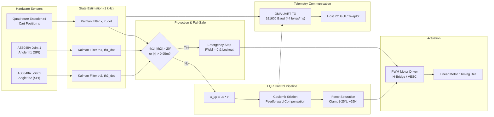

# Double Inverted Pendulum - Embedded Control Architecture & Telemetry

## 1. Embedded Control Architecture Block Diagram

---

## 2. Real-Time Timing Budget

Hard real-time timer interrupt cycle: $T_s = 1.0\text{ ms}$ (Frequency: $1000\text{ Hz}$).

| Task Inside Timer ISR | Estimated Execution Time (STM32 Cortex-M4 168MHz) | CPU Utilization |
| :--- | :--- | :--- |
| Read Timer Counter & SPI AS5048A (2 sensors) | $\approx 4.5\ \mu\text{s}$ | 0.45% |
| Update 3x Discrete 1-D Kalman Filters | $\approx 6.2\ \mu\text{s}$ | 0.62% |
| Fail-Safe Safety Guard & State Machine Check | $\approx 0.8\ \mu\text{s}$ | 0.08% |
| Compute LQR Control Law (6 multiply-accumulate) | $\approx 1.2\ \mu\text{s}$ | 0.12% |
| Coulomb Stiction Feedforward & PWM Clamping | $\approx 1.0\ \mu\text{s}$ | 0.10% |
| Pack Telemetry Frame & Trigger UART DMA | $\approx 3.0\ \mu\text{s}$ | 0.30% |
| **Total Worst-Case Execution Time (WCET)** | **$\approx 16.7\ \mu\text{s}$** | **$1.67\%$** |

> The control pipeline operates well within strict hard real-time requirements, leaving over **98% CPU headroom** for background communication, diagnostic logging, and trajectory generation.

---

## 3. High-Speed Binary Telemetry Packet Format

Telemetry packets are streamed via DMA UART at `921600 baud`, with a fixed size of 44 bytes per millisecond:

| Offset (Bytes) | Field Name | Data Type | Description |
| :--- | :--- | :--- | :--- |
| 0 .. 1 | `sync_header` | `uint16_t` | Synchronization word `0x55AA` |
| 2 .. 5 | `sequence_id` | `uint32_t` | Monotonically increasing packet counter |
| 6 .. 9 | `timestamp_us`| `uint32_t` | Microcontroller hardware timer timestamp ($\mu\text{s}$) |
| 10 .. 13 | `x` | `float` (32-bit) | Cart position ($m$) |
| 14 .. 17 | `x_dot` | `float` (32-bit) | Cart velocity ($m/s$) |
| 18 .. 21 | `th1` | `float` (32-bit) | Pendulum 1 angle ($rad$) |
| 22 .. 25 | `th1_dot` | `float` (32-bit) | Pendulum 1 angular rate ($rad/s$) |
| 26 .. 29 | `th2` | `float` (32-bit) | Pendulum 2 angle ($rad$) |
| 30 .. 33 | `th2_dot` | `float` (32-bit) | Pendulum 2 angular rate ($rad/s$) |
| 34 .. 37 | `u_command` | `float` (32-bit) | Total commanded control force ($N$) |
| 38 .. 41 | `pwm_duty` | `float` (32-bit) | Motor PWM duty cycle ($-100\%$ to $+100\%$) |
| 42 | `status_flags` | `uint8_t` | Bit 0: Active, Bit 1: Trip Angle, Bit 2: Trip Cart, Bit 3: Force Saturated |
| 43 .. 44 | `checksum_crc16` | `uint16_t` | CCITT CRC-16 checksum across bytes 0..42 |
