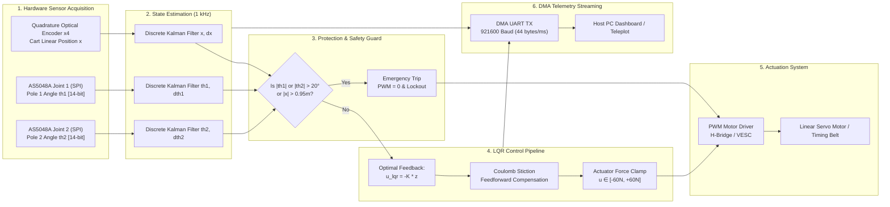

# Double Inverted Pendulum - Embedded Control Architecture & Telemetry

This document details the hard real-time 1 kHz embedded software architecture, timing budget, and telemetry protocol for the Double Inverted Pendulum (DIP) controller.

---

## 1. Embedded Control Architecture Block Diagram

---

## 2. Hard Real-Time Timing Budget

The control loop runs inside a dedicated Hardware Timer Interrupt Service Routine (Timer ISR) at exactly **1000 Hz** (Sampling Period: **Ts = 1.0 ms = 1000 µs**).

### Execution Time Breakdown (Measured on ARM Cortex-M4 @ 168 MHz)

| Pipeline Stage | Operation Description | Execution Time | CPU Utilization |
| :--- | :--- | :--- | :--- |
| Sensor Read | Hardware Timer register read & SPI DMA transfer (2x AS5048A) | ~4.5 µs | 0.45% |
| Kalman Filter | Time update & measurement correction for 3 independent 1-D KFs | ~6.2 µs | 0.62% |
| Safety Check | Angle threshold checks and track boundary monitoring | ~0.8 µs | 0.08% |
| LQR Control | 6 multiply-accumulate operations: u = - sum(K_i * z_i) | ~1.2 µs | 0.12% |
| Friction Comp | Coulomb stiction feedforward and actuator PWM duty clamping | ~1.0 µs | 0.10% |
| Telemetry | Binary frame packing and triggering non-blocking DMA UART TX | ~3.0 µs | 0.30% |
| **Total WCET** | **Worst-Case Execution Time per 1 ms interrupt cycle** | **~16.7 µs** | **1.67%** |

> **Real-Time Margin:** The entire control pipeline takes less than **17 µs**, leaving more than **98% CPU headroom** available for non-critical background tasks, communications, and logging.

---

## 3. High-Speed Binary Telemetry Packet Format

Telemetry is streamed to the host computer using a compact binary frame over UART at **921600 baud, 8-N-1**.

- **Packet Frequency:** 1000 Hz (1 packet every 1 ms)
- **Total Frame Size:** Exactly 44 bytes
- **Bandwidth Consumption:** 44 KB/s (under 48% of 921600 baud theoretical throughput)
- **Error Checking:** CRC-16 CCITT (Polynomial 0x1021)

### Packet Byte Layout Table

| Byte Offset | Field Name | Type | Size | Units | Description |
| :--- | :--- | :--- | :--- | :--- | :--- |
| 0 .. 1 | `sync_header` | uint16 | 2 B | - | Frame sync word: `0x55AA` |
| 2 .. 5 | `sequence_id` | uint32 | 4 B | count | Incrementing packet counter (0 to 2^32-1) |
| 6 .. 9 | `timestamp_us`| uint32 | 4 B | µs | Microcontroller timer counter in microseconds |
| 10 .. 13 | `x` | float32| 4 B | m | Estimated cart position along guide rail |
| 14 .. 17 | `x_dot` | float32| 4 B | m/s | Estimated cart linear velocity |
| 18 .. 21 | `th1` | float32| 4 B | rad | Estimated Link 1 angle from vertical |
| 22 .. 25 | `th1_dot` | float32| 4 B | rad/s | Estimated Link 1 angular rate |
| 26 .. 29 | `th2` | float32| 4 B | rad | Estimated Link 2 angle from vertical |
| 30 .. 33 | `th2_dot` | float32| 4 B | rad/s | Estimated Link 2 angular rate |
| 34 .. 37 | `u_command` | float32| 4 B | N | Commanded motor control force |
| 38 .. 41 | `pwm_duty` | float32| 4 B | % | Actuator PWM duty cycle (-100.0% to +100.0%) |
| 42 | `status_flags` | uint8 | 1 B | bitmask | Diagnostic status bitfield (see table below) |
| 43 .. 44 | `checksum_crc16` | uint16 | 2 B | - | CCITT CRC-16 calculated over bytes 0 to 42 |

### Status Flags Bitmask Definition

| Bit | Name | Value | Meaning When Set (1) |
| :--- | :--- | :--- | :--- |
| Bit 0 | `STATUS_BALANCING` | 0x01 | System is actively stabilizing in closed-loop |
| Bit 1 | `STATUS_FAILSAFE_TH`| 0x02 | Emergency trip: Angle exceeded threshold (|th| > 20°) |
| Bit 2 | `STATUS_FAILSAFE_X` | 0x04 | Emergency trip: Cart position reached track limit (|x| > 0.95m) |
| Bit 3 | `STATUS_SATURATED` | 0x08 | Commanded force reached actuator saturation limit |
| Bit 4 | `STATUS_ENC_FAULT` | 0x10 | Magnetic encoder parity error or reading timeout |
