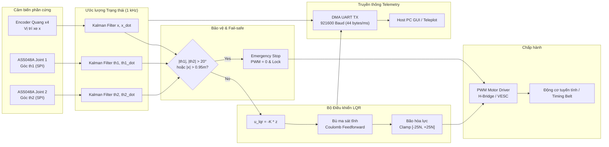

# Double Inverted Pendulum - Embedded Control Architecture & Telemetry

## 1. Sơ đồ Khối Hệ thống Điều khiển Nhúng (Control Block Diagram)

---

## 2. Ngân sách Thời gian Thời gian thực (Real-time Timing Budget)

Chu kỳ ngắt cứng định thời: $T_s = 1.0\text{ ms}$ (Tần số $1000\text{ Hz}$).

| Công việc trong ngắt ISR | Thời gian thực thi ước tính (STM32 Cortex-M4 168MHz) | Tỉ lệ sử dụng CPU |
| :--- | :--- | :--- |
| Đọc Timer Counter & SPI AS5048A (2 cảm biến) | $\approx 4.5\ \mu\text{s}$ | 0.45% |
| Cập nhật 3 Bộ lọc Kalman 1-D | $\approx 6.2\ \mu\text{s}$ | 0.62% |
| Kiểm tra an toàn Fail-safe & Trạng thái | $\approx 0.8\ \mu\text{s}$ | 0.08% |
| Tính toán LQR (6 phép nhân tích lũy) | $\approx 1.2\ \mu\text{s}$ | 0.12% |
| Bù ma sát Coulomb & Cắt bão hòa PWM | $\approx 1.0\ \mu\text{s}$ | 0.10% |
| Đóng gói Telemetry & Kích hoạt UART DMA | $\approx 3.0\ \mu\text{s}$ | 0.30% |
| **Tổng thời gian xử lý (Worst-Case)** | **$\approx 16.7\ \mu\text{s}$** | **$1.67\%$** |

> Hệ thống đáp ứng tiêu chuẩn thời gian thực khắt khe, dành tới hơn **98% CPU headroom** cho các tác vụ nền, giao thức truyền thông mạng hoặc trajectory planning.

---

## 3. Cấu trúc Gói tin Telemetry (Binary Frame Protocol)

Gói tin được truyền qua DMA UART tốc độ cao `921600 baud`, độ dài cố định 44 bytes mỗi 1 ms:

| Offset (Bytes) | Trường | Kiểu dữ liệu | Ý nghĩa |
| :--- | :--- | :--- | :--- |
| 0 .. 1 | `sync_header` | `uint16_t` | `0x55AA` (Mã đồng bộ) |
| 2 .. 5 | `sequence_id` | `uint32_t` | Số thứ tự gói tin (0 .. $2^{32}-1$) |
| 6 .. 9 | `timestamp_us`| `uint32_t` | Thời gian vi điều khiển ($\mu\text{s}$) |
| 10 .. 13 | `x` | `float` (32-bit) | Vị trí xe trượt ($m$) |
| 14 .. 17 | `x_dot` | `float` (32-bit) | Vận tốc xe trượt ($m/s$) |
| 18 .. 21 | `th1` | `float` (32-bit) | Góc thanh lắc 1 ($rad$) |
| 22 .. 25 | `th1_dot` | `float` (32-bit) | Vận tốc góc thanh lắc 1 ($rad/s$) |
| 26 .. 29 | `th2` | `float` (32-bit) | Góc thanh lắc 2 ($rad$) |
| 30 .. 33 | `th2_dot` | `float` (32-bit) | Vận tốc góc thanh lắc 2 ($rad/s$) |
| 34 .. 37 | `u_command` | `float` (32-bit) | Lực điều khiển thực tế ($N$) |
| 38 .. 41 | `pwm_duty` | `float` (32-bit) | Chu kỳ nhiệm vụ PWM ($-100\%$ đến $+100\%$) |
| 42 | `status_flags` | `uint8_t` | Trạng thái: Bit 0=Active, Bit 1=Trip TH, Bit 2=Trip X, Bit 3=Saturated |
| 43 .. 44 | `checksum_crc16` | `uint16_t` | Mã kiểm tra lỗi chuẩn CRC-16 CCITT |
